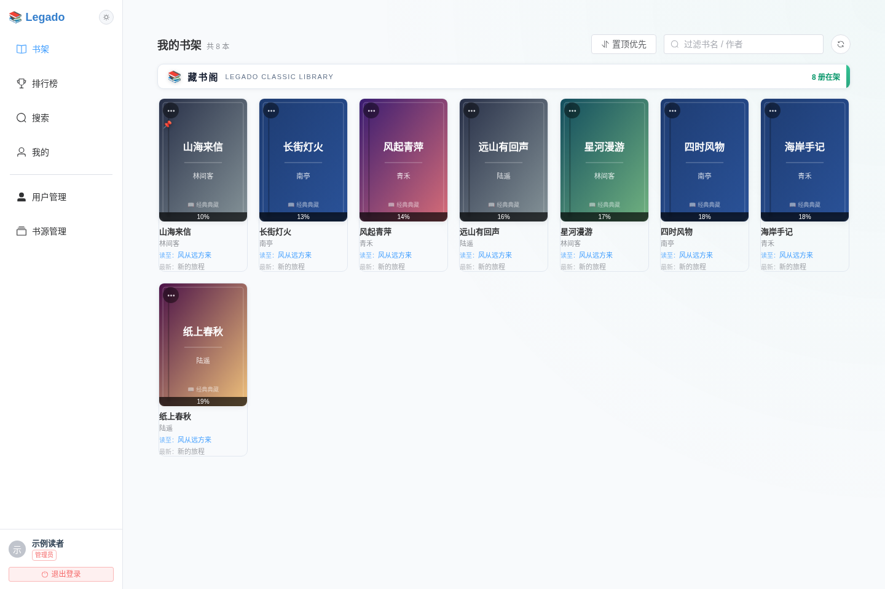
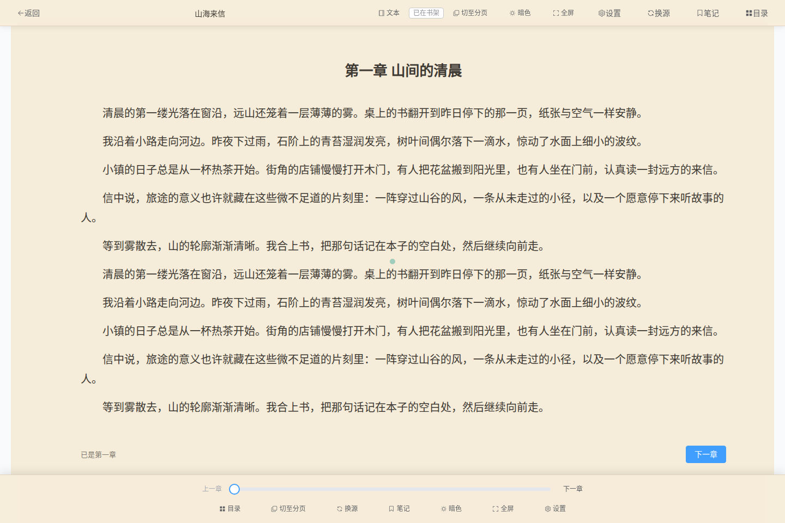
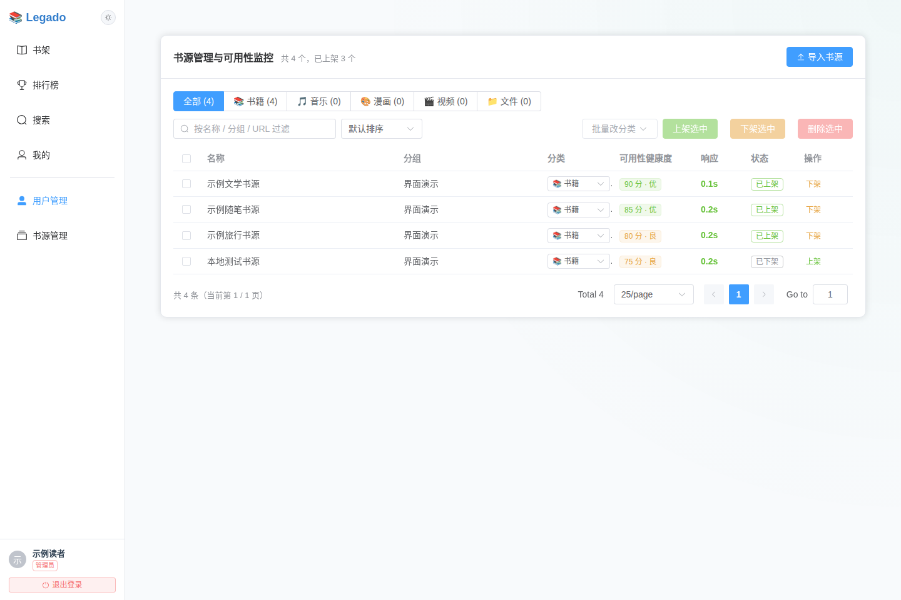
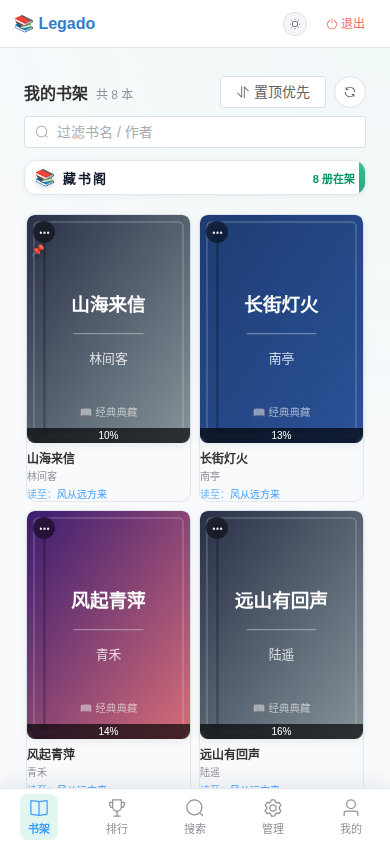

<div align="center">


# Legado Web

基于 Legado 规则引擎的多用户在线阅读平台。<br />
集中管理书源，在桌面、手机和平板上搜索、收藏与阅读。

<p>
  <a href="LICENSE"></a>
  <a href="https://github.com/wei-ran233/legado-web/actions/workflows/test.yml"></a>
  <a href="https://github.com/wei-ran233/legado-web/actions/workflows/web.yml"></a>
  
  
</p>

[页面预览](#页面预览) · [核心功能](#核心功能) · [设备适配](#设备适配) · [快速开始](#快速开始) · [配置说明](#配置说明) · [开发与构建](#开发与构建) · [问题反馈](https://github.com/wei-ran233/legado-web/issues)

</div>

## 项目介绍

Legado Web 基于 [Luoyacheng/legado-E](https://github.com/Luoyacheng/legado-E) 与 [gedoor/legado](https://github.com/gedoor/legado) 的开源成果开发，将书源规则解析迁移至纯 JVM 模块，并通过 Ktor 服务端与 Vue 3 前端提供浏览器阅读体验。

项目支持多用户独立书架、阅读进度同步、聚合搜索和管理员书源管理，适合个人自托管与多账号使用。当前维护范围为 Web 前端、JVM 服务端与规则引擎；仓库中的 Android 历史源码保留作参考，不参与当前构建。

## 页面预览

以下图片由当前 Web 前端在浏览器中实际渲染并截图。书架、正文、账号与书源使用本地模拟接口提供的虚构示例数据，仅用于展示界面，不代表预置书籍、可用书源或线上服务状态。

### 桌面书架

书架支持过滤、排序、置顶与主题布局，集中展示在读书籍和章节进度。



### 阅读器

阅读器提供章节目录、翻页、主题与排版设置。



### 书源管理与移动端

管理员可以筛选、导入和管理书源；移动端通过底部导航访问常用功能。

<table>
  <tr>
    <th width="72%">书源管理</th>
    <th width="28%">移动端书架</th>
  </tr>
  <tr>
    <td valign="top"></td>
    <td valign="top"></td>
  </tr>
</table>

## 核心功能

| 功能 | 说明 |
| --- | --- |
| 多用户书架 | 独立收藏、阅读记录与进度同步；管理员创建和管理账号 |
| 聚合搜索 | 并发查询多个书源，通过 SSE 逐步返回结果 |
| 规则引擎 | 基于 Legado 的规则解析与 Rhino JavaScript 执行环境，不依赖 Android SDK |
| 响应式阅读 | 桌面与移动端布局，支持章节导航、快捷键翻页和字号、行距、页宽调整 |
| 主题与书架布局 | 提供经典、蔚蓝画报、星河极光、浅樱落雪、黑曜赛博等应用主题 |
| 书源管理 | 导入、编辑、测试、删除与批量上架 / 下架；普通用户仅能访问已上架书源 |
| 账号安全 | JWT 访问令牌、Refresh Token 轮换、TOTP 两步验证、一次性恢复码与登录限速 |
| 缓存与部署 | 正文和图片磁盘缓存、定时清理；支持 Docker Compose 与 JVM 直接运行 |

书源的兼容性与可用性取决于具体规则及目标站点，需自行验证。项目不提供第三方内容授权，使用前请阅读下方[法律声明与版权合规须知](#法律声明与版权合规须知)。

## 设备适配

同一套 Web 界面会根据浏览器窗口宽度调整布局，电脑和手机均可通过浏览器访问，无需安装客户端。

| 使用场景 | 适配方式 |
| --- | --- |
| 电脑端 | 使用侧栏或主题对应的顶部导航，宽屏书架展示多列书籍；阅读器支持调整页宽、字号和行距，并提供方向键、Page Up / Page Down 等翻页操作 |
| 手机端 | 窄屏下切换为移动端顶部栏与底部导航，书架按可用宽度排列；阅读器支持触屏操作，分页模式支持左右滑动翻页，点击屏幕中央可呼出阅读工具栏 |
| 平板与窗口缩放 | 按实际视口宽度选择布局；横竖屏切换或调整窗口尺寸后重新排版 |
| 跨设备阅读 | 登录同一账号后，可访问个人书架并同步阅读进度；主题与排版偏好保存在各设备的浏览器中，可分别调整 |

主导航在视口宽度不超过 `768px` 时切换为移动端布局，并为底部导航预留空间及设备安全区域。不同主题的导航和书架样式有所区别；阅读页面隐藏主导航，将空间留给正文和阅读工具栏。

上方截图分别展示了 `1440 × 960` 的电脑端和 `390 × 844` 的手机端视口，便于对照两种布局。

## 快速开始

### Docker Compose

需要安装 Git、Docker 和 Docker Compose。

1. 克隆仓库：

   ```bash
   git clone https://github.com/wei-ran233/legado-web.git
   cd legado-web
   ```

2. 生成签名密钥，并将结果填入 [`docker-compose.yml`](docker-compose.yml) 的 `JWT_SECRET`：

   ```bash
   openssl rand -hex 32
   ```

   请替换 Compose 文件中的示例值。管理员用户名和初始密码也可在同一文件中设置。

3. 构建并启动服务：

   ```bash
   docker compose up -d --build
   ```

4. 若未设置 `ADMIN_PASSWORD`，查看首次启动时生成的管理员密码：

   ```bash
   docker compose logs legado-server | grep -A3 "管理员账号"
   ```

5. 浏览器访问 `http://localhost:8080`；远程部署时，将 `localhost` 替换为服务器地址。登录后导入可合法使用的书源并上架，再进行搜索和阅读。

默认将数据持久化到仓库下的 `data/` 目录，备份时应同时保留数据库及相关数据文件。更多服务端说明见 [README-SERVER.md](README-SERVER.md)。

### Windows 启动脚本

项目提供 [`start-server.bat`](start-server.bat) 与 [`stop-server.bat`](stop-server.bat)。完成下面的构建准备后，可双击启动脚本，默认访问地址为 `http://127.0.0.1:9000`；停止时运行停止脚本。

首次构建需要满足[开发与构建](#开发与构建)中的环境要求。启动脚本包含本地开发用的示例 `JWT_SECRET`，部署前请替换为自行生成的随机密钥。

## 配置说明

以下环境变量由服务端直接读取：

| 变量 | 默认值 | 说明 |
| --- | --- | --- |
| `JWT_SECRET` | 无，必填 | JWT 签名密钥，建议用 `openssl rand -hex 32` 生成 |
| `PORT` | `8080` | 服务监听端口；Windows 启动脚本默认设为 `9000` |
| `DATA_DIR` | `data` | 数据目录，存放数据库、正文缓存、图片缓存与前端产物 |
| `ADMIN_USERNAME` | `admin` | 首次初始化时创建的管理员用户名 |
| `ADMIN_PASSWORD` | 随机生成并打印至日志 | 首次初始化的管理员密码；已有账号不会被此配置覆盖 |

当前服务端默认每 24 小时执行一次缓存巡检，保留最近 7 天的缓存。`CACHE_EXPIRE_DAYS` 等脚本变量尚未接入服务端环境配置。

## 开发与构建

### 环境要求

- **JDK 24**：当前 Gradle 配置使用 Java 24 工具链；生成的 JVM 字节码目标为 Java 17。
- **Node.js 20+** 与 **pnpm 9+**：用于前端依赖安装和构建。
- 仅构建 Web / JVM 模块，无需 Android SDK。

### 构建并运行

以下命令从仓库根目录执行，适用于 Linux / macOS：

```bash
# 构建后端
./gradlew :server:installDist

# 构建前端
(cd modules/web && pnpm install --frozen-lockfile && pnpm build-only)

# 同步前端资源
mkdir -p data/webapp
cp -R modules/web/dist/. data/webapp/

# 从仓库根目录启动，确保数据路径与前端产物一致
export JWT_SECRET="$(openssl rand -hex 32)"
export PORT=8080
export DATA_DIR="$PWD/data"
./server/build/install/server/bin/server
```

Windows 下使用 `gradlew.bat :server:installDist` 构建后端，在 `modules/web` 中执行相同的 pnpm 命令，再将 `dist` 内容复制到 `data/webapp`。

### 项目结构

```text
modules/web/       Vue 3 + TypeScript 前端
modules/engine/    纯 JVM 书源规则引擎
server/           Ktor 服务端、认证、业务接口与缓存服务
docs/images/      README 头图与界面截图
app/              Android 历史源码，仅供参考
```

请求链路为 `Vue Web → Ktor API → JVM 规则引擎 → 书源站点`；服务端使用 SQLite（Exposed ORM、WAL 模式）保存业务数据，并在 `DATA_DIR` 中保存缓存与静态资源。

## API 概览

API 前缀为 `/api`，受保护接口使用 `Authorization: Bearer <access_token>`。业务响应采用以下结构：

```json
{
  "isSuccess": true,
  "errorMsg": "",
  "data": null
}
```

| 模块 | 主要接口 |
| --- | --- |
| 认证 | `POST /api/auth/login`、`POST /api/auth/2fa/verify`、`POST /api/auth/refresh` |
| 个人账户 | `GET /api/me`、`PATCH /api/me/password`、`POST /api/me/2fa/setup` |
| 搜索与阅读 | `POST /api/search/stream`、`GET /api/book/{url}/toc`、`GET /api/book/content` |
| 书架与进度 | `GET /api/bookshelf`、`POST /api/bookshelf`、`DELETE /api/bookshelf`、`GET /api/progress`、`POST /api/progress` |
| 管理后台 | `GET /api/admin/users`、`GET /api/admin/sources`、`POST /api/admin/sources/import` |

更多接口说明见 [服务端文档](README-SERVER.md#api-概览前缀-api)，具体请求参数以 [`server/`](server/src/main/kotlin/io/legado/app/server/api) 中的路由实现为准。

## 参与贡献

欢迎通过 [Issues](https://github.com/wei-ran233/legado-web/issues) 提交问题或建议，通过 [Pull Requests](https://github.com/wei-ran233/legado-web/pulls) 贡献改进。反馈问题时，请附上运行环境、复现步骤和已脱敏的日志。

涉及前端或服务端代码时，可分别执行以下检查：

```bash
(cd modules/web && pnpm build)
./gradlew :server:test
```

## 致谢

感谢 [gedoor/legado](https://github.com/gedoor/legado) 与 [Luoyacheng/legado-E](https://github.com/Luoyacheng/legado-E) 提供的开源实现与规则引擎基础。本项目在上游成果之上持续开发，原作者版权信息与开源许可予以保留。

## 法律声明与版权合规须知

> [!IMPORTANT]
> 本项目是开源阅读技术工具，不提供对第三方作品或网站的使用授权。使用、部署、运营本项目时，请遵守适用法律及第三方合法权益。本声明不排除开发者或部署运营者依法应承担的责任。

1. **项目定位及上游成果**：
   - Legado Web 基于 [Luoyacheng/legado-E](https://github.com/Luoyacheng/legado-E) 与 [gedoor/legado](https://github.com/gedoor/legado) 的开源成果二次开发，提供规则解析、多用户阅读和缓存等软件功能。
   - 项目的技术研究、开源或非营利属性不等于任何未经授权的获取、复制或传播行为合法。

2. **第三方书源与版权内容**：
   - 书源是第三方资源的访问与解析规则，书源可用不代表内容已获授权。请仅访问、导入或分享依法可以使用的书源和作品。
   - 项目具备书源导入及管理员上架、网络搜索、正文与图片磁盘缓存和多用户阅读功能。**本项目不能笼统保证所有部署环境均不存储或传输第三方内容**；具体内容由实际部署、配置和使用情况决定。
   - 请勿利用本项目绕过付费或技术保护措施，或未经授权复制、传播他人的作品。

3. **用户与部署运营者责任**：
   - 自行部署或运营服务的用户应核验内容来源、授权范围及适用法律，妥善设置书源访问权限、缓存策略和侵权内容处理机制。
   - 用户、部署运营者和开发者的责任应结合各自具体行为、实际控制能力、过错及适用法律认定；本声明不以约定方式免除任何依法不得免除的责任。
   - 面向公众提供服务时，部署运营者应特别注意公开书源、多人共享内容、服务器缓存及传播行为可能产生的版权和其他合规义务。

4. **版权投诉与处理**：
   - 如认为本仓库中的代码、文档、示例或项目维护者实际提供的内容侵犯您的合法权益，请通过 [GitHub Issues](https://github.com/wei-ran233/legado-web/issues) 或邮件 **[liweimin@wrcode.online](mailto:liweimin@wrcode.online)** 联系维护者。
   - 为便于核查，请提供权利人及联系方式、权属或授权依据、涉嫌侵权的具体仓库路径或链接、问题说明及您希望采取的措施。请勿在公开 Issue 中发布身份证件、私人地址等敏感资料。
   - 维护者收到有效通知后，将结合可核实信息和适用法律及时评估，并在必要时采取更正、移除或其他适当措施。对于独立第三方部署的服务，请同时联系该服务的实际运营者。

5. **GPLv3 开源许可与合法使用**：
   - 本项目中依据 [GNU GPLv3](LICENSE) 授权的代码，使用、修改、复制和分发权利依该许可证确定，包括 GPLv3 允许的商业使用；本声明不另行设置与 GPLv3 冲突的全面商业使用禁令。
   - GPLv3 对软件代码的授权不等于对第三方小说、图书、图片、书源内容或商标的授权。任何商业或非商业活动均须遵守相关法律并取得必要授权。

6. **无担保与责任限制**：
   - 在适用法律允许的范围内，软件按照 GNU GPLv3 所载条件以“原样”（AS IS）提供，不作适销性、特定用途适用性等保证。具体担保与责任限制以许可证条款和适用法律为准。

---

## 开源许可证与版权声明

本项目遵循 [GNU General Public License v3.0 (GPL-3.0)](LICENSE) 开源协议发布。

```
Copyright (C) 2026 wei-ran233 <https://github.com/wei-ran233/legado-web>
Copyright (C) 2024-2026 Luoyacheng <https://github.com/Luoyacheng/legado-E>
Copyright (C) 2019-2023 gedoor <https://github.com/gedoor/legado>
```
